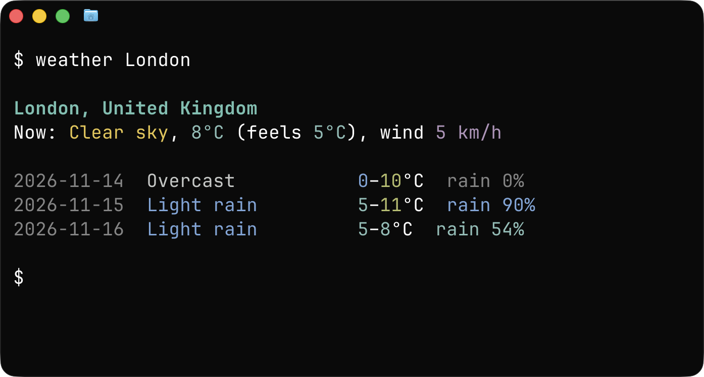

# weather-cli

> Check the weather from your terminal. Colour-coded, no API key, standard library only.

<p align="center">
  
</p>

A small command-line weather tool for macOS, Linux and Windows. Check the forecast for your current location (or any city) straight from the terminal, with colour-coded output and an optional look back at the past week.

Built with Python's standard library only. Weather data comes from [Open-Meteo](https://open-meteo.com) (no API key needed).

## Features

- Detects your location from your IP address, or pass any city name
- Current conditions plus a 1 to 7 day forecast
- Optional look back at the past 1 to 7 days, clearly labelled as past data
- Metric (°C, km/h, mm) or imperial (°F, mph, in) units
- Colour-coded temperatures, conditions, rain and wind
- Colour switches off automatically when piped or when `NO_COLOR` is set
- Works on macOS, Linux and Windows
- No third-party dependencies

## Requirements

- macOS, Linux, or Windows 10 and newer
- Python 3.9 or newer
- [pipx](https://pipx.pypa.io) (installs the command so it works from any folder)

## Installation

### 1. Install pipx (once)

**macOS**

```bash
brew install pipx
pipx ensurepath
```

**Linux**

```bash
sudo apt install pipx          # Debian/Ubuntu
# sudo dnf install pipx        # Fedora
# sudo pacman -S python-pipx   # Arch
pipx ensurepath
```

**Windows (PowerShell)**

```powershell
py -m pip install --user pipx
py -m pipx ensurepath
```

Then **close and reopen your terminal** so the PATH change applies.

### 2. Install weather-cli

This works on every OS and needs no `git`:

```bash
pipx install https://github.com/calified/weather-cli/archive/refs/heads/main.zip
```

If you have `git` installed, this also works:

```bash
pipx install git+https://github.com/calified/weather-cli.git
```

To update later, run the same command again with `--force` added.

### 3. Try it

```bash
weather
```

### For development

```bash
git clone https://github.com/calified/weather-cli.git
cd weather-cli
pipx install -e .
```

The `-e` flag installs in editable mode, so code changes apply immediately without reinstalling.

## Usage

```bash
weather                     # your location, 3-day forecast
weather Manchester          # a specific city
weather New York            # multi-word cities work without quotes
weather Manchester -p       # forecast plus the past 3 days
```

### Options

| Flag | Description | Values |
|---|---|---|
| `-d`, `--days` | Number of forecast days | 1 to 7 (default 3) |
| `-u`, `--units` | Unit system | `metric` or `imperial` (default `metric`) |
| `-p`, `--past [N]` | Also show the past N days | 1 to 7 (3 if no number is given) |
| `-h`, `--help` | Show help | |

### Examples

```bash
weather -d 1                      # just today
weather London -d 7               # a week in London
weather -u imperial               # detected location in °F and mph
weather Tokyo -u imperial -d 5    # flags can be combined in any order
weather -p                        # past 3 days plus forecast
weather -p 7                      # past week plus forecast
weather London -p 2 -d 1          # past 2 days, then today only
```

### Past days

With `-p`, the output is split into two labelled sections:

```
Past 3 days (recorded, not forecast)
2026-11-11  Rain               5–9°C  rain 3.2 mm
...

Forecast
2026-11-14  Overcast           4–10°C  rain 20%
...
```

Past days show the total rainfall that fell (mm or inches), because a rain *probability* only exists for future days. The limit is 7 days back.

If you give a city and `-p` together, put the city first (`weather London -p 3`). Writing `weather -p London` makes the tool try to read "London" as the number of days.

## Configuration

### Default units

**macOS / Linux** (add to `~/.zshrc` or `~/.bashrc`, then restart the terminal):

```bash
export WEATHER_UNITS=imperial
```

**Windows (PowerShell)**

```powershell
setx WEATHER_UNITS imperial      # permanent, applies to new terminals
$env:WEATHER_UNITS = "imperial"  # this terminal only
```

An explicit `-u` flag always overrides this.

### Colour

Colour turns off automatically when output is piped or redirected.

| | macOS / Linux | PowerShell | Command Prompt |
|---|---|---|---|
| Disable for one run | `NO_COLOR=1 weather` | `$env:NO_COLOR=1; weather` | `set NO_COLOR=1 && weather` |

### Optional shortcuts

**macOS / Linux** (add to `~/.zshrc` or `~/.bashrc`):

```bash
alias wi='weather -u imperial'
alias wt='weather -d 1'
alias wp='weather -p'
```

**Windows (PowerShell)**: open your profile with `notepad $PROFILE` and add:

```powershell
function wi { weather -u imperial @args }
function wt { weather -d 1 @args }
function wp { weather -p @args }
```

## Project structure

```
weather-cli/
├── pyproject.toml
├── README.md
├── .gitignore
├── docs/
│   └── images/
│       └── default.png     # screenshot used in this README
├── src/
│   └── weather_cli/
│       ├── __init__.py
│       ├── __main__.py
│       ├── cli.py          # argument parsing, ties everything together
│       ├── colours.py      # colours the output (the installed entry point)
│       ├── geocoding.py    # place name / IP -> coordinates
│       ├── forecast.py     # coordinates -> weather data (past + forecast)
│       ├── display.py      # weather data -> formatted text
│       ├── codes.py        # weather code -> description
│       └── http.py         # shared JSON fetch helper
└── tests/
    ├── test_codes.py
    └── test_display.py
```

### How it works

1. `colours.py` is the entry point (`weather = "weather_cli.colours:main"` in `pyproject.toml`). It runs `cli.main()`, captures the printed text, and adds colour. On Windows it first enables ANSI colour support in the console.
2. `cli.py` parses arguments and asks `geocoding.py` for coordinates.
3. `forecast.py` fetches the weather from Open-Meteo in a single request. When `-p` is used, it adds Open-Meteo's `past_days` parameter, so the past days come back at the start of the same daily data.
4. `display.py` formats the result as plain text, splitting the past days from the forecast.

## Updating and uninstalling

```bash
pipx list                         # confirm it's installed
pipx uninstall weather-cli        # remove the command
pipx install -e . --force         # development install: reinstall after editing pyproject.toml
```

For an editable install, do not move or delete the project folder, since the install points at it. If you move it, uninstall and reinstall from the new location.

## Troubleshooting

| Problem | Fix |
|---|---|
| `weather: command not found` (macOS/Linux) | Run `pipx ensurepath`, then restart the terminal |
| `'weather' is not recognized` (Windows) | Run `py -m pipx ensurepath`, then close and reopen the terminal. `pipx ensurepath` also prints where the command lives |
| `py` is not recognized (Windows) | Install Python from python.org (tick "Add python.exe to PATH"), or use `python -m pip ...` instead of `py -m pip ...` |
| `pipx install git+...` fails with "git not found" | Install Git, or use the `.zip` install command instead |
| PowerShell blocks scripts when activating a venv | Run `Set-ExecutionPolicy -Scope CurrentUser RemoteSigned` once |
| Strange characters like `←[93m` instead of colour | Use Windows Terminal or PowerShell 7, or run with `NO_COLOR=1` to switch colour off |
| No colour in Git Bash on Windows | Expected on some setups. Output falls back to plain text. Windows Terminal or PowerShell shows colour |
| No colours (macOS/Linux) | Check `echo $NO_COLOR` is empty and `pyproject.toml` points to `weather_cli.colours:main`, then reinstall with `--force` |
| `SyntaxError` or `ImportError` on run | Check the named file and line in the traceback, or run `python3 -m compileall src` |
| Wrong location detected | IP lookup can be off (or affected by a VPN). Pass a city name instead |
| `Couldn't find a place called ...` | Try a different spelling or add a country, e.g. `weather Paris France` |
| `argument -p/--past: must be between 1 and 7` | `-p` only accepts 1 to 7 |
| `argument -p/--past: 'London' is not a number` | Put the city before `-p`: `weather London -p` |
| `rain n/a` on a day | Open-Meteo had no rain figure for that day |

## Running tests

```bash
python3 -m venv .venv
source .venv/bin/activate        # Windows: .venv\Scripts\Activate.ps1
pip install -e ".[dev]"
pytest
```

## Credits

- Weather and geocoding: [Open-Meteo](https://open-meteo.com)
- IP-based location: [ipinfo.io](https://ipinfo.io)